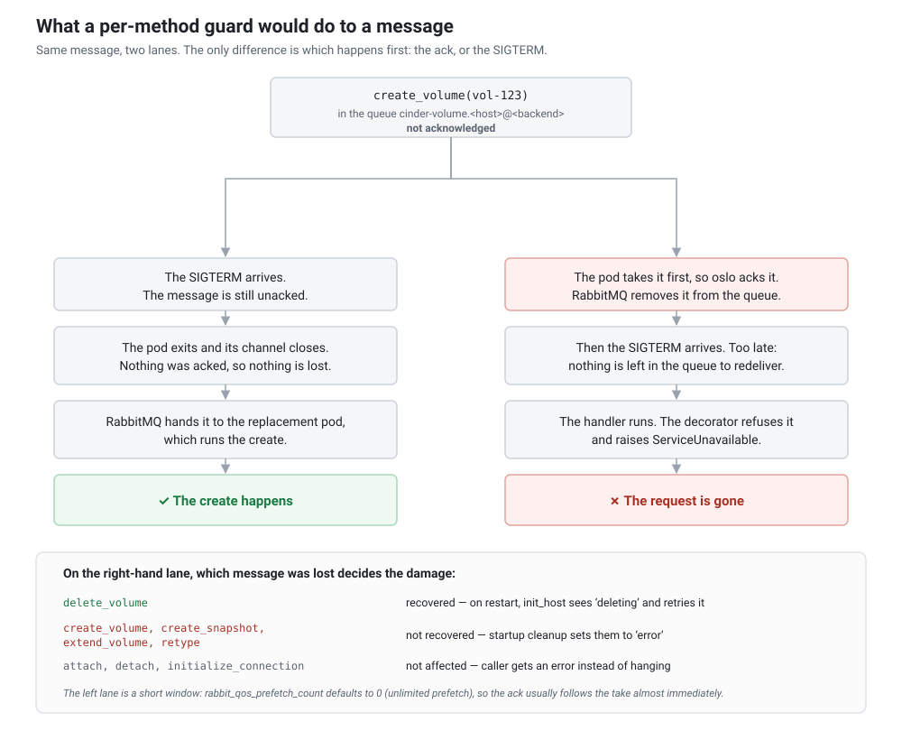
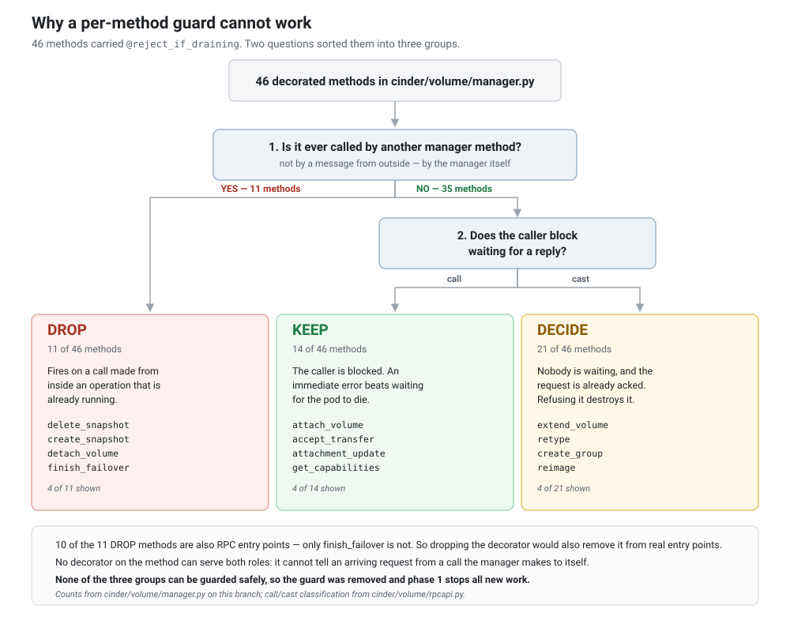

# Graceful Shutdown for Cinder Services

**Commit:** [de113e65ed](https://github.com/sapcc/cinder/commit/de113e65ed) - `[SAP] Implement graceful shutdown for cinder services`

## Overview

Cinder services run as Kubernetes containers in the SAP deployment model. When a pod is stopped (for example during a rolling update), Kubernetes sends `SIGTERM` to the container.

By default, Cinder services exit as soon as they receive that signal. For cinder-volume and cinder-backup this is a problem: those services run long operations (volume create/clone/delete, backup create/restore) that can be interrupted mid-way, leaving volumes and backups in an inconsistent state.

Graceful shutdown lets cinder-volume and cinder-backup drain in-flight operations before exiting, so that operations which were already running when the termination signal arrived are allowed to complete.

## Scope

Graceful shutdown is implemented for **two** services:

- **cinder-volume**
- **cinder-backup**

**cinder-api** is **not** covered by graceful shutdown; it terminates as soon as it receives the termination signal. **cinder-scheduler** runs the same `cinder.service.Service` used for `cinder-volume`/`cinder-backup`, so it uses the same `stop()` drain path — it has no long-running in-flight work of its own, so the effect is minimal. This is intentional:

- cinder-api is stateless with respect to long-running operations. Clients retry API calls that are interrupted by a shutdown, and the API service is restarted by the orchestrator.
- cinder-scheduler is stateless. Scheduling decisions are made on demand from the message queue, so an interrupted schedule is simply re-issued when a healthy scheduler picks up the message.

Nothing in the graceful shutdown mechanism should be relied upon for cinder-api.

## How It Works

When cinder-volume or cinder-backup receives a termination signal, the service shuts down in three phases:

1. **Stop accepting new work.** The RPC consumer stops, so messages that arrive from that point on stay on the queue and are taken by the replacement pod. New background tasks are refused.
2. **Drain in-flight operations.** The service waits for the RPC handler greenthreads that were already running to complete. When `graceful_shutdown_timeout` (default 120 seconds) expires, the service **keeps waiting** rather than tearing down underneath a running operation — the pod's `terminationGracePeriodSeconds` is the real bound, at which point Kubernetes SIGKILLs the container.
3. **Clean up and exit.** Coordination is stopped, the thread pool is drained, and the process exits naturally.

A message can reach a shutting-down pod by two paths, and only one of them has already been taken from the queue:

**Left:** the signal arrives while the message is still unacknowledged, so this pod never takes it. RabbitMQ redelivers it to the replacement pod and the operation still happens. **Right:** the pod takes and acknowledges the message first, RabbitMQ drops it, and only then does the signal arrive. Refusing the message at that point destroys it, because there is nothing left to redeliver — which is why nothing refuses it.

While the service is draining, the following mechanisms keep in-flight work safe across a rolling update:

- **Worker heartbeats.** In-flight operations keep touching the worker DB entries (and, for backups, the backup `updated_at`) so that a newly started pod does not consider them stale and reset them to error.
- **Freshness checks.** Startup cleanup skips worker entries and backups that were updated within `service_down_time`.

## Why no method rejects new work

New work is stopped by phase 1 and by nothing else. Once `rpcserver.stop()` returns, the consumer is gone and messages stay queued for the replacement pod. There is no per-method guard on the managers, and adding one would only affect the short window between the signal arriving and the consumer actually stopping.

In that window a guard cannot help. A message delivered there has already been acknowledged, so refusing it destroys the request rather than deferring it; a message that is allowed through simply runs and is covered by the phase 2 drain like any other in-flight handler. The same is true for the calls a running operation makes to other manager methods — those are ordinary Python calls, and rejecting one aborts the operation half-way through.

The diagram below is the analysis that led to removing the guard entirely. Of the 46 methods that carried it, none of the three groups could be guarded safely:

- **11 were called by another manager method.** The guard fired inside an operation that was already accepted.
- **14 were `call` entry points.** Refusing one turned a caller that would have been served into a caller that had to retry.
- **21 were `cast` entry points.** Nothing waits for the reply and the message was already acknowledged, so refusing it discarded the request.

Ten of the 11 in the first group were also RPC entry points, so no placement on the method could separate an arriving request from a call the manager makes to itself.

The failure this prevents: `delete_volume` with `cascade=True` is still running when the signal arrives. At `cinder/volume/manager.py` the cascade loop calls `self.delete_snapshot(...)`. With a guard there, that call raises, `delete_volume` catches it and sets the volume to `error_deleting`, and the re-raise skips `volume.destroy()`. The row survives in a state that startup cleanup ignores and that a normal `cinder delete` refuses, so only `cinder delete --force` clears it.

## Configuration

The drain wait is configured with `graceful_shutdown_timeout`. The default of 120 seconds is set in `cinder/service.py`; the option itself is provided by oslo.service.

## Eventlet dependency

This graceful shutdown implementation targets SAP's Epoxy release, which still runs cinder under eventlet (all cinder binaries call `eventlet.monkey_patch()`). The drain therefore relies on the eventlet executor's GreenPool (`pool.waitall()`), and the heartbeats run as eventlet greenthreads.

Upstream has deprecated the eventlet executor and plans to remove it in favor of the threading executor. The threading migration for graceful shutdown will be handled in the upstream effort, not in this Epoxy-targeted change.

## Deployment Requirements

In the SAP deployment model these services run as Kubernetes containers. Cinder itself has no knowledge of Kubernetes; the graceful shutdown mechanism relies only on receiving a termination signal. The following deployment settings are required for the mechanism to work:

- The container entrypoint must forward the termination signal to the Cinder process (for example `dumb-init --single-child`).
- The pod must allow enough time for in-flight operations to complete (`terminationGracePeriodSeconds` should be comfortably larger than `graceful_shutdown_timeout`).

These are deployment concerns, not Cinder code concerns.
